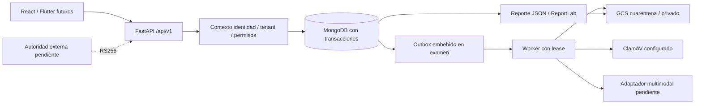

# Estado del backend WellQ

> **Vigencia tras cierre focalizado F01-F07 (2026-11-05):** F01-F07 cerrados con pruebas aisladas: 276 aprobadas, 209 omitidas; 61 casos nuevos. Integracion Docker y produccion clinica NO verificadas. [Detalle y evidencia](12_CIERRE_DEFECTOS_F01_F07.md).
> El contenido anterior al cierre se conserva a continuacion como referencia historica; esta nota y el documento12 prevalecen donde difieran.

**Fecha:** 2026-11-05 (America/Santiago). **Rama:** fix/wellq-backend-hardening. **Base:** fb8746cd42fe107bbda82dd92d3a4d11d545fd3e + cambios sin commit.

**Alcance:** backend; rutas de código relativas a wellq-clinical-tests-main/backend salvo indicación. **Método:** contraste estático, implementación y pruebas aisladas. **Límites:** sin servicios clínicos, datos reales, migraciones, despliegues ni validación clínica. No se modificó frontend.

## Resultado y límites
Se consolidó el módulo existente, conservando Python/FastAPI, MongoDB, GCS y las 20 operaciones clínicas bajo /api/v1. No es una reimplementación ni una certificación de producción. Se retiraron simulaciones de los caminos productivos; las integraciones pendientes fallan de forma explícita.

El árbol inicial estaba limpio en feature/juan-frontend, commit fb8746cd42fe107bbda82dd92d3a4d11d545fd3e. La referencia local origin/main coincidía. La rama de trabajo es fix/wellq-backend-hardening, sin commits, push, merge ni rebase. No se consultó la punta remota por red: no se afirma que la referencia local sea la más reciente en GitHub.

## Fuentes
Se contrastaron la auditoría externa C:/Dev/wellq-auditoria-codex, código actual, requisitos RF/RNF, DAS y documentos técnicos OOXML versionados. El Documento Maestro de 49 páginas y las especificaciones externas citadas no están en el inventario accesible. Se solicitó su ubicación; no se inventó su contenido. Las aclaraciones expresas del encargo —función lineal, puntuación tras confirmación de paciente y borrado local independiente de IA— se aplicaron como instrucciones del usuario.

## Arquitectura
- app/main.py: API, ciclo de conexión, CORS restringido, errores seguros y cabeceras no-store. Sin montajes /dashboard, /demo o /exports.
- app/dependencies/auth.py: verificación RS256 externa; identidad, organización, rol, permisos y capacidades separados. No hay emisor, registro ni login paralelo.
- app/tenancy.py: fachada cerrada que impone client_id en consultas y escrituras; datos antiguos sin tenant quedan invisibles.
- app/services/transactions.py: transacciones clínicas y revisión por paciente. Requiere replica set/sharded MongoDB y esquema provisionado.
- app/services/uploads.py: sesiones, replay, conflicto, cuotas y entrega al outbox embebido.
- app/services/storage.py y file_validation.py: GCS real, cuarentena, generación inmutable, hash/MIME/formato/escáner.
- app/workers/processing.py: trabajos persistidos en el examen, leases, fencing, backoff y recuperación.
- app/services/extractor.py: interfaz multimodal, entrada desde objeto verificado, esquema estricto y propuesta preservada. Proveedor real pendiente.
- catalog.py y scoring.py: catálogo original congelado, rechazo de no finitos, filtro temporal real, trazabilidad de inputs y snapshots.
- routes/extractions.py y clinical_tests.py: contratos HTTP existentes y reglas clínicas, reporte y PDF. models/reporting.py añade envelopes tipados.

## Estado defendible
La suite aislada verifica reglas y contratos con documentos sintéticos. No acredita IAM real, firmas GCS efectivas, antivirus real, transacciones/reintentos de servidor Mongo, precisión multimodal o aprobación clínica.
La API importa y genera OpenAPI sin iniciar servicios. El arranque real rechaza identidad ausente, Mongo standalone o índices tenant no provisionados. Los antiguos HTML quedan intactos, pero el backend ya no los publica ni acepta sus tokens HS256.

## Preparación
**Desarrollo con dobles:** contratos disponibles y verificados en proceso; puede iniciarse diseño de tipos y flujos de clientes con estas limitaciones.
**Integración real:** bloqueada por identidad, replica set/esquema, GCS, escáner y proveedor.
**Producción clínica:** no preparada; además requiere aprobación clínica, privacidad, retención y operación.

La matriz completa por fase y los bloqueos están en 10_PENDIENTES_Y_BLOQUEOS.md.

## Integridad final
Los dos HTML originales conservan exactamente sus SHA-256 de la linea base: backend/app/static/index.html y ../frontend/index.html. Todos los cambios versionados y archivos nuevos reportados por Git estan dentro de backend. No hay commits nuevos, push, merge, rebase, migraciones o despliegues. Git queda deliberadamente con cambios de trabajo para revision. change-manifest.json registra rutas y huellas de fuentes modificadas.
