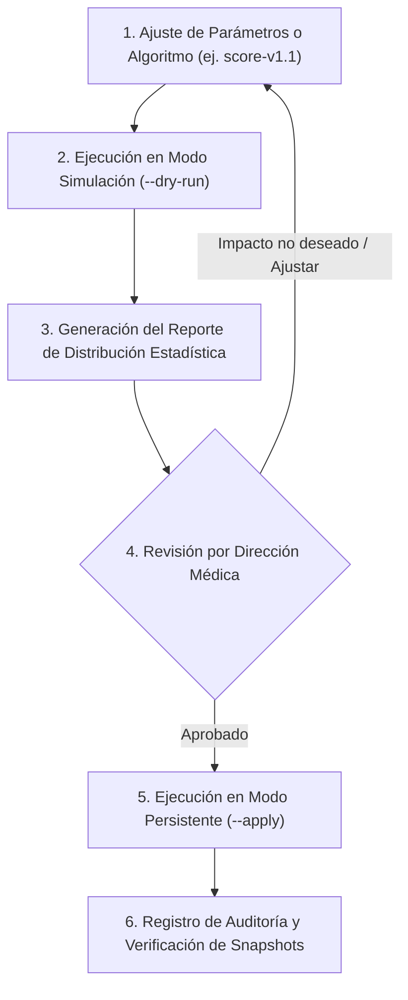

# WellQ — Procedimiento Operativo Estándar (SOP)
## Recálculo Controlado de Puntuaciones tras Cambio de Versión
> **Referencia normativa:** Documento Maestro §8.8 y §13.5 (Criterio de Aceptación Fase 4)  
> **Ámbito de aplicación:** Equipo de Desarrollo Backend, DevOps y Dirección Médica de WellQ.

---

### 1. Objetivo y Principios de Diseño
Garantizar que cualquier evolución en los algoritmos de puntuación (`scoring_version`), cambios en rangos óptimos del catálogo canónico o ajustes en los pesos por pilar:
1. **Sea auditable y reproducible:** Nunca se sobrescriben ni eliminan los snapshots históricos de los pacientes.
2. **Sea predecible clínicamente:** Se simula primero en modo `--dry-run` para comparar las distribuciones estadísticas poblacionales antes y después.
3. **No altere la continuidad asistencial:** Los médicos siempre pueden consultar la evolución histórica (`?history=true`) en el portal.

---

### 2. Ciclo de Vida de un Cambio de Versión



---

### 3. Paso a Paso para la Ejecución

#### Paso 1: Simulación y Comparación Estadística (Dry-Run)
Antes de persistir cualquier cambio, el operador ejecuta el script en modo de simulación. Esto calculará el nuevo score para todos los pacientes con exámenes confirmados sin modificar la base de datos:

```bash
docker exec wellq-api python scripts/recompute_scoring.py --version "score-v1.1" --output exports/simulacion_v1.1.md
```

#### Paso 2: Evaluación del Informe de Distribución
El script genera una tabla comparativa con las siguientes métricas poblacionales antes vs después:
* **Desplazamiento del promedio ($\Delta \mu$):** Cuántos puntos subió o bajó el `lab_index` global.
* **Dispersión ($\sigma$) y Cuartiles (P25, P50, P75):** Permite verificar que la nueva versión no polarice los puntajes de manera anómala.
* **Pilares de Salud:** Evaluación independiente para Cardio, Músculo, Articulación y Hueso.
* **Casos extremos:** Detección de las mayores subidas y mayores caídas individuales.

El archivo generado en `exports/` debe ser revisado y firmado por el Director Médico o responsable clínico.

#### Paso 3: Aplicación Controlada (Apply)
Una vez obtenida la aprobación clínica, se ejecuta la persistencia masiva:

```bash
docker exec wellq-api python scripts/recompute_scoring.py --version "score-v1.1" --apply --output exports/recalculo_oficial_v1.1.md
```

**Efectos de la ejecución:**
1. Se crea un nuevo documento inmutable en `score_snapshots` para cada paciente con:
   * `trigger: "recompute"`
   * `scoring_version: "score-v1.1"`
   * `computed_at: <ISO timestamp actual>`
2. Los snapshots anteriores permanecen intactos como registros históricos.
3. Se inserta un registro en la colección `audit_logs` con la fecha, operador, versión y estadísticas del lote.

---

### 4. Verificación y Rollback

* **Verificación de la API:**  
  Al consultar el Endpoint #18 (`GET /api/v1/patients/{id}/lab-score?history=true`):
  * `current_snapshot` devuelve el snapshot generado con `trigger: "recompute"` y la nueva versión.
  * `history` contiene el snapshot anterior (`trigger: "extraction_confirmed"` o `"clinician_correction"`).
* **Rollback en caso de contingencia:**  
  Dado que los registros son inmutables y ordenados cronológicamente por `computed_at`, para revertir basta con ejecutar el script apuntando a la versión anterior (`--version "score-v1.0" --apply`), restaurando la versión anterior como el snapshot vigente más reciente.
